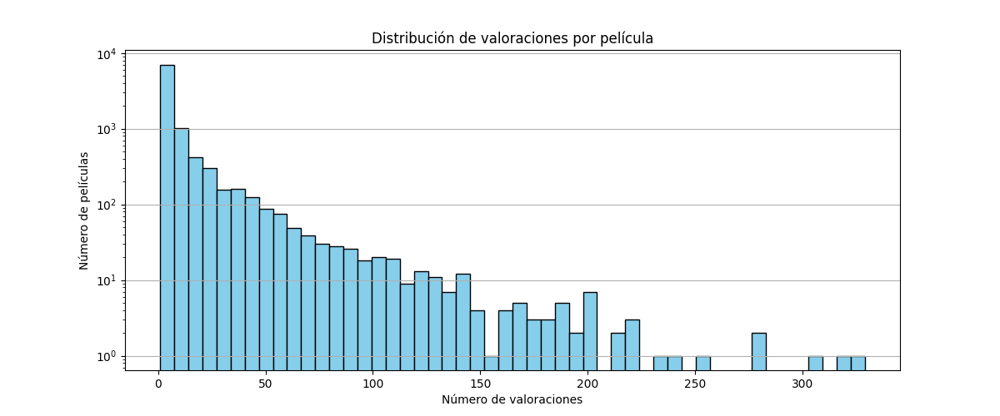
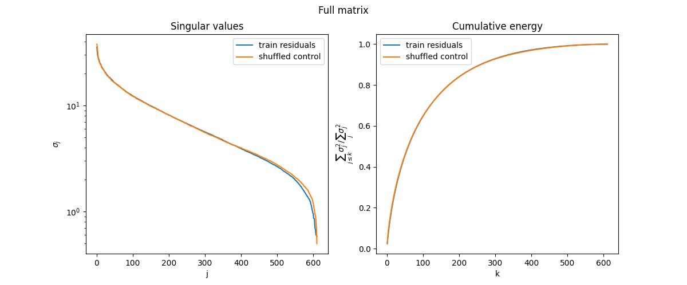
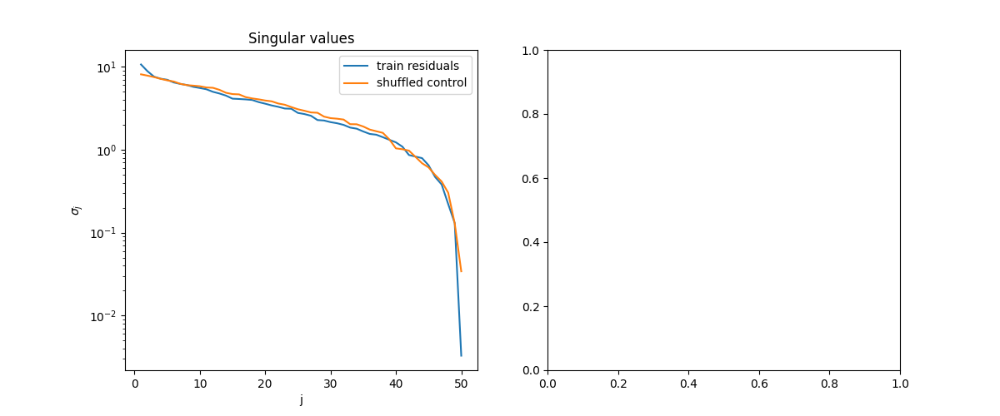
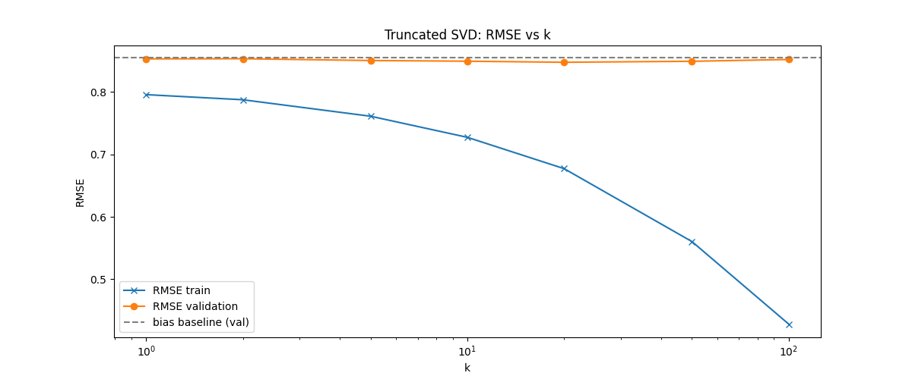
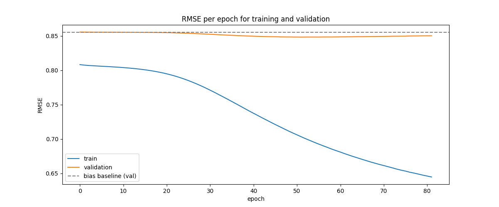
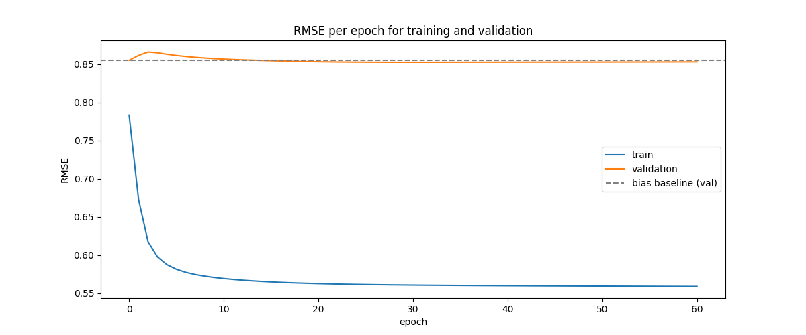
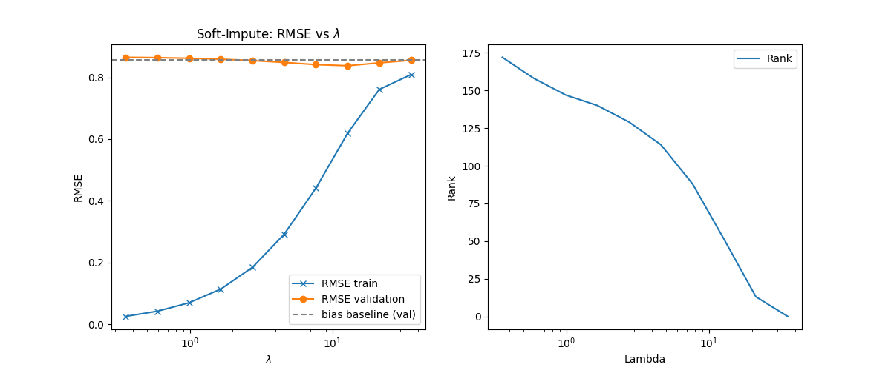

# SpectralRec

Final project based on MIT 18.065.

Goal: predict the rating a user would give to a movie, using the known
ratings of other users and movies.

## Data

Source: MovieLens Latest Small (GroupLens). Downloaded on 2026-10-16.

| Statistic | Value |
|---|---|
| Users | 610 |
| Movies in the catalog | 9742 |
| Ratings | 100836 |
| Movies with at least one rating | 9724 |
| Rating density | 1.70% |
| Min ratings per user | 20 |
| Max ratings per user | 2698 |
| Median ratings per user | 70.5 |
| Min ratings per movie | 1 |
| Max ratings per movie | 329 |
| Median ratings per movie | 3.0 |
| Movies with a single rating | 3446 |

## Train / validation / test split

- Random split (not by date): 80% train, 10% validation, 10% test.
- Split seed: 42
- Rows removed because their user or movie does not appear in train:

| Set | Rows removed | Share |
|---|---|---|
| Validation | 371 | 3.68% |
| Test | 391 | 3.88% |

Why: The model has no information about a movie (or user) that never appears in train, so it cannot predict its ratings. These are mostly rarely-rated movies, whose few ratings all fell into validation or test. Since rare movies are harder to predict, removing them makes the evaluation optimistic, and it says nothing about how the model performs on new or rare movies.

## Singular value spectrum

Singular values of the residual matrix were compared to the singular values of a matrix where the residuals were permuted.
Also a dense submatrix was extracted from the residuals matrix, using the 50 users and 50 movies with the most train ratings,
and its singular values were computed and compared with the singular values of this matrix with the non zero values permuted. The results were the following:

| Matrix | Real σ₁ | Control σ₁ (20 shuffles) |
|---|---|---|
| Full | 35.55 | 36.81–38.61 |
| Dense 50 × 50 | 10.64 | 7.67–8.70 |

The bigger value of the first singular value in the dense matrix compared to the first singular value of the permuted matrix suggests that $\sigma_1$ captures something the shuffle does not reproduce, although this does not prove it reflects tastes.
In the full residual matrix $\sigma_1$ stays below the control values and this shows the test does not detect patterns and the shuffling changes something else apart from the tastes.

**Proof that $\|M\|_F^2 = \sum_j \sigma_j^2$.** With $M = U \Sigma V^\top$:

$$\|M\|_F^2 = \mathrm{tr}(M^\top M) = \mathrm{tr}(V \Sigma^2 V^\top) = \mathrm{tr}(\Sigma^2 V^\top V) = \mathrm{tr}(\Sigma^2) = \sum_j \sigma_j^2$$

The more zeros in the matrix the less information we can get from the residuals in relation to tastes. SVD treats each missing cell as a real value of 0, so with 98.3% of the cells missing, the spectrum mostly reflects where the ratings are, not which residual sits in each cell. The biggest singular values of the full matrix and the permuted matrix are very similar. In the dense matrix, the first singular value exceeds those of all 20 controls.

## Truncated SVD (Eckart–Young)

|   k | RMSE train | RMSE val |
|-----|------------|----------|
|   1 |     0.7956 |   0.8529 |
|   2 |     0.7874 |   0.8531 |
|   5 |     0.7610 |   0.8503 |
|  10 |     0.7273 |   0.8491 |
|  20 |     0.6771 |   0.8474 |
|  50 |     0.5604 |   0.8490 |
| 100 |     0.4283 |   0.8519 |

Bias baseline (predicted residual 0): validation RMSE 0.8554.

The training RMSE falls steadily with k, from 0.7956 at k = 1 to 0.4283 at k = 100, because the truncated SVD approximates the training residual matrix more closely as k grows. The validation RMSE barely moves: its best value, 0.8474 at k = 20, is less than 0.01 below the bias baseline. The reason is the zero filling. Validation pairs are empty cells of the training matrix, stored as 0. With small k, the approximation of an almost all-zero matrix is small everywhere, and with large k it reproduces those zeros. In both cases, the predicted residuals for validation pairs stay close to 0, so the model predicts almost the same ratings as the biases alone.

## Matrix factorization with SGD

Same residuals as the truncated SVD, but the loss only uses the observed training ratings, with no zero filling:

$$L(U,V) = \sum_{(u,i)\in\text{train}}\Big[(\tilde r_{ui} - U_u\cdot V_i)^2 + \lambda\big(\lVert U_u\rVert^2 + \lVert V_i\rVert^2\big)\Big]$$

Configuration (`configs/sgd.json`): k = 10, lr = 0.01, reg = 0.1, scale = 0.1, patience = 30, model seed = 0, n_epochs = 500.

| | Value |
|---|---|
| Best epoch | 51 |
| Validation RMSE at best epoch | 0.8483 |
| Bias baseline (validation) | 0.8554 |
| Time per epoch | 0.47 s |

Validation stops improving after epoch 51. There is overfitting as the validation error increases while the training error keeps decreasing. With reg = 0.05, the validation curve stayed flat at the baseline; with reg = 0.1 it went down to 0.8483, so the regularization is the first hyperparameter I would explore.

## Matrix factorization with ALS

Same loss as SGD with weighted = true using ALS to minimize it:

$$L(U,V) = \sum_{(u,i)\in\text{train}}\Big[(\tilde r_{ui} - U_u\cdot V_i)^2 + \lambda\big(\lVert U_u\rVert^2 + \lVert V_i\rVert^2\big)\Big]$$

Configuration (`configs/als.json`): k = 10, weighted = true, reg = 0.1, scale = 0.1, patience = 30, model seed = 0, n_epochs = 500.

| | Value |
|---|---|
| Best iteration | 30 |
| Validation RMSE at best iteration | 0.8526 |
| Bias baseline (validation) | 0.8554 |
| Time per iteration | 0.12 s |

Comparison with SGD on the same split (seed 42), with the same k = 10 and the same loss (reg = 0.1):

| | SGD | ALS |
|---|---|---|
| Best epoch / iteration | 51 | 30 |
| Validation RMSE | 0.8483 | 0.8526 |
| Training RMSE | 0.7032 | 0.5608 |
| Time per epoch / iteration | 0.47 s | 0.12 s |
| Total training time | 38.1 s | 7.3 s |

Both methods minimize the same loss, but ALS solves each half step exactly, so it gets much closer to the minimum of the training loss: its training RMSE (0.5608) is much lower than SGD's (0.7032). Getting closer to that minimum also means fitting the training noise more, and ALS ends up slightly worse on validation (0.8526 vs 0.8483). SGD was stopped at epoch 51 by early stopping, which watches the validation error and stops after `patience` epochs without improvement. Stopping before the minimum acts as extra regularization on top of λ. ALS is also about five times faster: 0.12 s per iteration against 0.47 s per epoch, and 7.3 s in total against 38.1 s.

## Nuclear norm regularization with Soft-Impute

Compute X matrix by copying the observed residual values and the rest 0 or a chosen initialization matrix. Compute SVD of X, shrink its singular values by subtracting $\lambda$ from them and keep factors with resulting singular value positive, compute Z from kept factors and shrunk singular values and compute new X by copying the observed residuals to Z. Iterate until the change in the values of Z from previous Z squared relative to the norm of Z also squared is smaller than tol or a maximum number of iterations is reached.

$$L(Z) =\ \tfrac12 \sum_{(u,i)\in\text{train}}(\tilde r_{ui} - Z_{ui})^2 + \lambda\lVert Z\rVert_*$$

Configuration (`configs/soft.json`): max_iter = 300, tol = 1e-8, split_seed = 42. The $\lambda$ are chosen from a list that starts at the maximum singular value of the residual matrix of train with zeros in the cells without rating, and ends at this singular value divided by 100 with 10 elements evenly spaced on a log scale in total. For each $\lambda$ an initialization matrix is provided being the Z matrix solution computed for the previous $\lambda$.

|        λ | rank | RMSE train | RMSE val | seconds |
|----------|------|------------|----------|---------|
|   35.545 |    0 |     0.8091 |   0.8554 |     0.5 |
|   21.309 |   13 |     0.7609 |   0.8470 |    16.6 |
|   12.774 |   51 |     0.6187 |   0.8377 |    35.9 |
|    7.658 |   88 |     0.4409 |   0.8413 |    63.0 |
|    4.591 |  114 |     0.2915 |   0.8484 |    96.6 |
|    2.752 |  129 |     0.1844 |   0.8544 |   120.4 |
|    1.650 |  140 |     0.1139 |   0.8589 |   115.8 |
|    0.989 |  147 |     0.0696 |   0.8620 |    89.5 |
|    0.593 |  158 |     0.0422 |   0.8639 |    60.7 |
|    0.355 |  172 |     0.0255 |   0.8649 |    36.0 |

At the first value, λ = σ₁ = 35.545, every singular value is shrunk to zero: Z is the zero matrix (rank 0) and the validation RMSE equals the bias baseline. As λ decreases, Z keeps more singular values and its rank grows up to 172. The training RMSE keeps falling, down to 0.0255, but the validation RMSE reaches its minimum at λ = 12.774 (0.8377, rank 51) and rises below it. From λ ≈ 1.65 on, it is worse than the baseline: small values of λ overfit.

The best validation RMSE, 0.8377, beats the bias baseline (0.8554) and all the previous models: truncated SVD 0.8474 (k = 20), SGD 0.8483 and ALS 0.8526. The comparison favors Soft-Impute, though: it was tuned over 10 values of λ, while SGD and ALS were trained with hand-picked values of reg and might improve with a proper search. At the best λ, Soft-Impute uses 51 factors, more than SGD and ALS (k = 10) or truncated SVD (k = 20), but shrunk instead of whole: truncated SVD with 50 whole factors gave 0.8490, worse than with 20.

Each iteration takes about 0.5 s, the time of one SVD of the full matrix, so each λ takes roughly its number of iterations times 0.5 s. The time per λ grew until λ ≈ 2.75 and then fell, probably because of the warm start: for the smaller values of λ, the solution of the previous λ is already close to the new one, so fewer iterations are needed.

### ALS and Soft-Impute solve the same problem

$$\lVert Z\rVert_* = \min_{AB^\top = Z}\ \tfrac12\big(\lVert A\rVert_F^2 + \lVert B\rVert_F^2\big)$$

The regularization term in ALS, $\big(\lVert A\rVert_F^2 + \lVert B\rVert_F^2\big)$, is double the regularization term in Soft-Impute, $\lVert Z\rVert_*$, for the factorization that is chosen by ALS at the minimum. As the error term is also double, ALS and Soft-Impute end up choosing the same Z.

This equivalence between these two models was checked in an experiment. A synthetic matrix of 30 users and 20 movies is computed from two random matrices with two columns, so the final matrix has rank 2 and some noise added to this matrix. ALS is trained on 300 ratings with weighted = False, k=20 and reg=0.01. Soft-Impute is trained on the same data with the same lambda as the reg parameter in ALS. 

The computed losses below show that ALS loss is exactly double the Soft-Impute loss:

ALS loss: 0.1833334

Soft-Impute loss: 0.0916667
