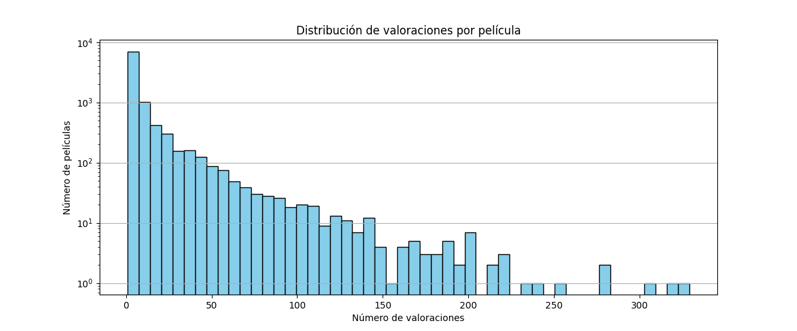
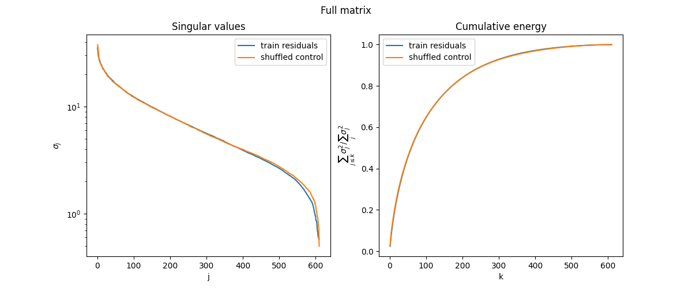
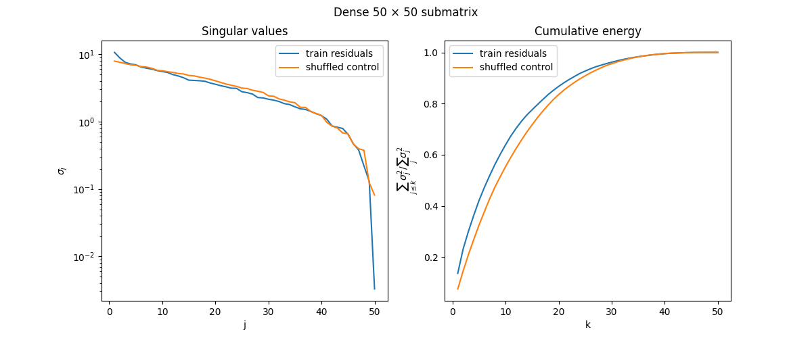

# SpectralRec

Final project based on MIT 18.065.

Goal: predict the rating a user would give to a movie, using the known
ratings of other users and movies.

## Data

Source: MovieLens Latest Small (GroupLens). Downloaded on 2026-10-16.

| Statistic | Value |
|---|---|
| Users | 610 |
| Movies in the catalog | 9742 |
| Ratings | 100836 |
| Movies with at least one rating | 9724 |
| Rating density | 1.70% |
| Min ratings per user | 20 |
| Max ratings per user | 2698 |
| Median ratings per user | 70.5 |
| Min ratings per movie | 1 |
| Max ratings per movie | 329 |
| Median ratings per movie | 3.0 |
| Movies with a single rating | 3446 |

## Train / validation / test split

- Random split (not by date): 80% train, 10% validation, 10% test.
- Split seed: 42
- Rows removed because their user or movie does not appear in train:

| Set | Rows removed | Share |
|---|---|---|
| Validation | 371 | 3.68% |
| Test | 391 | 3.88% |

Why: The model has no information about a movie (or user) that never appears in train, so it cannot predict its ratings. These are mostly rarely-rated movies, whose few ratings all fell into validation or test. Since rare movies are harder to predict, removing them makes the evaluation optimistic, and it says nothing about how the model performs on new or rare movies.

## Singular value spectrum

Singular values of the residual matrix were compared to the singular values of a matrix where the residuals were permuted.
Also a dense submatrix was extracted from the residuals matrix, using the 50 users and 50 movies with the most train ratings,
and its singular values were computed and compared with the singular values of this matrix with the non zero values permuted. The results were the following:

| Matrix | Real σ₁ | Control σ₁ (20 shuffles) |
|---|---|---|
| Full | 35.55 | 36.81–38.61 |
| Dense 50 × 50 | 10.64 | 7.67–8.70 |

The bigger value of the first singular value in the dense matrix compared to the first singular value of the permuted matrix suggests that $\sigma_1$ captures something the shuffle does not reproduce, although this does not prove it reflects tastes.
In the full residual matrix $\sigma_1$ stays below the control values and this shows the test does not detect patterns and the shuffling changes something else apart from the tastes.

**Proof that $\|M\|_F^2 = \sum_j \sigma_j^2$.** With $M = U \Sigma V^\top$:

$$\|M\|_F^2 = \operatorname{tr}(M^\top M) = \operatorname{tr}(V \Sigma^2 V^\top) = \operatorname{tr}(\Sigma^2 V^\top V) = \operatorname{tr}(\Sigma^2) = \sum_j \sigma_j^2$$

The more zeros in the matrix the less information we can get from the residuals in relation to tastes. SVD treats each missing cell as a real value of 0, so with 98.3% of the cells missing, the spectrum mostly reflects where the ratings are, not which residual sits in each cell. The biggest singular values of the full matrix and the permuted matrix are very similar. In the dense matrix, the first singular value exceeds those of all 20 controls.
